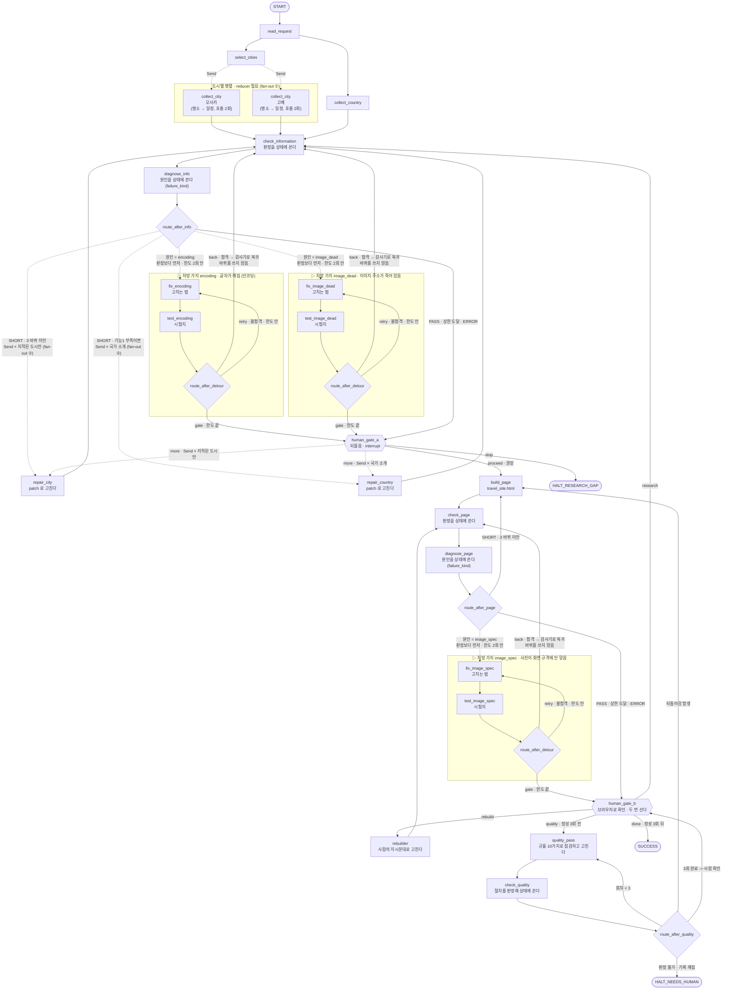

# 그래프 인계본 — 일본 4일

**이 파일 하나로 그래프를 설계할 수 있습니다.**
루프 킷을 끝까지 돌린 결과에서 기계가 뽑았습니다. 손으로 고치지 마세요 —
결정이 바뀌면 `python scripts/export_graph_handoff.py` 를 다시 돌리면 됩니다.

---

## 1. 목표

```text
일본 4일 여행 정보 웹페이지 하나(단일 HTML)를 만든다.
도시 2개 · 도시마다 관광지 3곳 · 취향 설명 15줄
일정은 도시마다 따로 4일 — 어느 도시로 갈지 고르기 위한 페이지다
```

취향 원문은 `02_USER_REQUEST.md` 에 있습니다. **요약본으로는 15줄짜리
취향 설명이 안 나옵니다.** 그 파일을 반드시 같이 넘기세요.

## 2. 루프에서 그대로 가져오는 것 (건드리지 마세요)

| 루프의 조건 | 그래프에서 | 어디에 있나 |
| --- | --- | --- |
| 관측 표면 (화면 이름표) | **그대로** | `03_CONTRACT.json` 의 `page_contract` |
| 충족 기준 (개수 계약) | **그대로** | `03_CONTRACT.json` 의 `count_contract` |
| 판정 독립 (검사기가 밖에) | **그대로** | `scripts/check_*.py` — 루프 킷 파일과 바이트 단위로 같음 |
| 종료 선언 (성공 조건) | **그대로** | 아래 6번 |

> 이 넷을 바꾸면 루프판과 그래프판을 **같은 자로 잴 수 없게 됩니다.**
> 실습의 요점이 '같은 계약, 다른 실행 구조'이므로 계약은 고정입니다.

## 3. 노드 — 루프의 작업 8개가 어떻게 옮겨지나

**작업 8개**는 루프 킷 `specs/04_BOUNDARY_TASKS_SAFETY.md` 의 **권장 작업 7개**(`D-작업목록` A)에 킷이 고정으로 넣는 `TASK-정성점검` 을 더한 수입니다. 그래프 킷은 이 권장 목록을 기준으로 대응을 고정해 두었으므로 루프에서 B(5개로 합치기)나 C(직접 정의)를 골랐어도 아래 표는 같습니다.

**1:1로 옮기지 않습니다.** 2개는 노드가 아니게 되고, 8개가 새로 생겨 **루프 골격 6 + 8 = 14개**가 됩니다.
여기에 검사기 바로 뒤 **진단 노드 2개**가 붙어 **루프 골격 14 + 진단 2** 입니다.
규칙 처방 가지(등록부 한 줄 = 노드 2개)는 진단 노드에서만 갈라지므로 따로 셉니다 — 킷 기본 3개를 더하면 Studio 그림에는 **14 + 2 + 3×2 = 22개**가 보입니다.

| 루프 작업 | 그래프에서 | 종류 | 왜 |
| --- | --- | --- | --- |
| `TASK-입력읽기` | `read_request` | 노드 | 요청서를 읽어 상태의 입력 칸을 채운다 |
| `TASK-국가정보` | `collect_country` | 노드 · 병렬 | 도시와 무관하므로 도시 선정과 나란히 돌 수 있다 |
| `TASK-도시선정` | `select_cities` | 노드 | 여기서 도시 수가 정해져야 뒤쪽 병렬 폭이 결정된다 |
| `TASK-명소수집` | `collect_city` | 노드 · 도시별 병렬 | 도시끼리 서로의 결과를 안 보므로 fan-out 가능 |
| `TASK-일정수집` | `collect_city 에 합침` | - | 같은 도시의 명소만 참조한다. 책임도 재시도 전략도 같으므로 노드를 나누지 않는다. 다만 한 응답에 다 담으면 분량이 잘리므로 **노드 안에서 호출만** 두 번 한다 (명소 -> 일정). 노드 경계와 호출 단위는 다른 문제다 |
| `TASK-페이지생성` | `build_page` | 노드 | 모든 수집이 끝난 뒤 한 번만 돈다 |
| `TASK-기능점검` | `(간선)` | 노드가 아니다 | check_page -> diagnose_page -> build_page 로 되돌아가는 간선(진단 B 뒤 route_after_page 의 retry)이 이 일을 대신한다 |
| `TASK-정성점검` | `quality_pass` | 노드 · 순차 3회 | 회차 번호가 상태에 있어야 라우터가 셀 수 있다. 앞 회차의 출력이 자기 입력이라 **병렬이 아니라 순환**으로만 돈다 |

### 루프에는 없던 노드 10개 (루프 골격 8 · 진단 2)

| 노드 | 루프에서는 | 왜 노드가 되나 |
| --- | --- | --- |
| `check_information` | 검사기 A | 라우터가 읽을 판정 값을 상태에 써야 하므로 노드가 된다 |
| `check_page` | 검사기 B | 같은 이유. 판정이 상태에 남아야 간선이 조건을 볼 수 있다 |
| `human_gate_a` | 되물음 ① | interrupt 로 멈추고 사람의 답을 상태에 받아 적는다 |
| `human_gate_b` | 되물음 ② | 같은 이유. 선택지가 달라서 노드를 따로 둔다. 정성 3회 전후로 **두 번 선다** |
| `check_quality` | 검사기 C | 품질이 아니라 절차(3회를 규율대로 돌았는가)를 판정해 상태에 쓴다 |
| `repair_city` | RESEARCH 행동 (루프 안의 분기) | 재수집도 fan-out 이다. 검사기가 지적한 도시만 Send 로 받는다. 첫 수집과 한 노드로 두면 지적 없는 도시가 첫 수집으로 떨어져 통째로 다시 뽑힌다 |
| `rebuilder` | 없음 | 사람이 게이트에 적은 지시문을 실제로 소비하는 자리. build_page 는 결정론 렌더러라 지시문을 받을 데가 없다 |
| `repair_country` | RESEARCH 행동 | 국가 소개도 지적된 칸만 patch 로 고친다. 도시와 같은 fan-out 을 탄다. 수집 노드로 되돌아가면 합류가 다른 갈래를 영영 기다려 조용히 멈추므로 재수집은 반드시 별도 노드여야 한다 |
| `diagnose_info` | 없음 (루프는 모든 실패를 '한 바퀴 더'로 뭉쳤다) | 검사기 A 바로 뒤. **판정**(기준을 채웠나) 다음에 **원인**(무엇이 터졌나)을 가려 `failure_kind` 를 상태에 쓴다. 그래야 라우터가 처방 가지를 고를 수 있다. 판정이 PASS 여도 돈다 · 결정론 |
| `diagnose_page` | 없음 | 검사기 B 바로 뒤. 같은 이유. 검사기는 사진이 '있는가'만 보므로 화면 규격 같은 결함은 진단이 따로 잡는다 |

```text
루프에서 검사기는 '돌려 보고 종료 코드를 읽는 것'이었다.
그래프에서 검사기는 '판정 값을 상태에 쓰는 노드'다.
간선이 조건을 보려면 그 값이 상태에 있어야 하기 때문이다.
진단은 그 바로 뒤에서 '원인 값을 상태에 쓰는 노드'다.
라우터는 판정(기준을 채웠나)과 원인(무엇이 터졌나)을 나란히 읽는다.
```

### 규칙 처방 가지 — 진단 노드에서만 갈라진다 (킷 기본 3개)

루프는 모든 실패를 '한 바퀴 더'로 뭉쳐 처리했습니다. 그래프에서는 **정해진 고칠 법이
있는 실패만** 처방 가지로 보내고, 나머지는 재수집(LLM)이 맡습니다. 모든 처방 가지가
같은 모양입니다.

```text
 check_* ─▶ ◇diagnose_* ─┬─ (처방 가지 대상 없음) ────────────▶ 루프 골격 그대로
                         └─ <이름> ─▶ fix_<이름> ─▶ test_<이름> ─┬ 합격           → check_*   (검사기로 복귀 · 바퀴 안 씀)
                                                                ├ 불합격 · 한도 안 → fix_<이름> (한 번 더)
                                                                └ 불합격 · 한도 끝 → ★human_gate_* (사람)
```

| 처방 가지 | 루프 | 시험지가 보는 것 | 노드 | 합격하면 | 한도 끝나면 |
| --- | --- | --- | --- | --- | --- |
| `encoding` 글자가 깨짐 (인코딩) | A | 깨진 글자 · 모지바케 · 비ASCII 주소 | `fix_encoding` → `test_encoding` | `check_information` | `human_gate_a` |
| `image_dead` 이미지 주소가 죽어 있음 | A | 열었더니 404 · 금지된 주소 형태 · 이미지가 아닌 페이지 | `fix_image_dead` → `test_image_dead` | `check_information` | `human_gate_a` |
| `image_spec` 사진이 화면 규격에 안 맞음 | B | 원본 통째(width 없음) · 사진 틀 CSS 없음 · 가려진 사진 | `fix_image_spec` → `test_image_spec` | `check_page` | `human_gate_b` |

**실제 목록은 그래프 킷의 `travel_graph/detours/registry.py` 입니다.** 이 표는 킷 기본
3개의 사본이라, 그래프 킷 STEP 6 에서 처방 가지를 더하면 달라집니다. 등록 순서가 곧
진단 우선순위입니다.

**노드는 처방 가지로만 늘립니다.** 루프 골격 14개와 진단 2개는 잠겨 있습니다. 처방 가지는
판정 · 바퀴 · 게이트 칸을 쓰지 않고, 합격하면 수집 노드가 아니라 **그 루프의 검사기**로
돌아옵니다 — 수집 노드로 돌아가면 합류가 영영 기다립니다. 진단과 합격은 **같은 시험지**로
보고, 시험지는 고치는 코드를 import 하지 않습니다 (판정 독립).

## 4. 상태 스키마

```python
from typing import Annotated, TypedDict
import operator

class TravelState(TypedDict):
    # 입력 — 노드가 바꾸지 않는다
    country: str
    days: int
    style: dict
    city_priority: list[str]

    # 수집 결과 — 노드가 채운다
    country_intro: dict
    cities: Annotated[list[dict], merge_cities]   # 병렬이 쓴다 -> reducer 필수
                                                  # operator.add 가 아니다 (아래)
    city_failures: Annotated[list[dict], merge_failures]  # 수집이 실패한 도시
    selected_city_names: list[str]   # 여기서 병렬 폭이 정해진다

    # 판정 — 검사기 노드가 쓰고, 라우터가 읽는다
    info_verdict: str          # UNKNOWN | PASS | SHORT | ERROR
    info_short_slots: list[str]
    page_verdict: str
    page_short_slots: list[str]
    quality_verdict: str
    quality_short_slots: list[str]

    # 루프 C — 회차 카운터. ★ reducer 를 붙이면 안 된다 (덮어쓰기다)
    quality_pass: int              # 0 -> 3
    quality_passes_required: int   # 3. 계약에서 온다

    # 사람이 적어 넣는 칸 — 게이트가 interrupt 로 받는다
    gate_a_answer: str         # more | proceed | stop
    gate_b_answer: str         # research | rebuild | done
    gate_note: str             # 자유 문장. **라우팅에 쓰지 않는다**

    # 산출물 — 경로만. 본문은 파일에 둔다
    html_path: str
    research_path: str

    # 제어
    loop_a_iter: int
    loop_a_limit: int
    loop_b_iter: int
    loop_b_limit: int
    same_error_count: int
    same_error_limit: int
    last_error_hash: str

    # 진단 · 처방 가지 — 킷 고정. 판정은 검사기 노드가, **원인**은 진단 노드가 쓴다
    #   처방 가지는 한 번에 하나만 돌므로 reducer 가 없다 (전부 덮어쓰기)
    inject: list[str]            # 실패 재현 (입력). 평소 []
    failure_kind: str            # "" | 등록된 처방 가지 이름. **라우터가 읽는 원인 칸**
    failure_evidence: list[str]  # 증상 몇 줄. 게이트 화면용 — **라우팅에 쓰지 않는다**
    detour_attempts: dict        # {처방 가지 이름: 이번에 몇 번 돌았나}. 게이트에서 more · research · rebuild 를 고를 때만 {}
    detour_limit: int            # 2. 처방 한도 — 처방 가지 하나가 사람 없이 돌 수 있는 횟수
    detour_verdict: str          # "" | PASS | FAIL. 시험 노드가 쓰고 검사기 노드가 읽고 비운다

    history: Annotated[list[str], operator.add]
```

**진단 · 처방 가지 칸 6개는 킷 고정입니다.** 판정(`*_verdict`)과 원인(`failure_kind`)은
다른 칸입니다 — 판정은 "기준을 채웠나", 원인은 "무엇이 터졌나 · 정해진 고칠 법이 있나".
`failure_evidence` 는 `gate_note` 처럼 자유 문장이라 **라우팅에 쓰지 않습니다.**
`detour_attempts` 는 회차 카운터와 같은 규칙입니다 — reducer 없이 덮어씁니다.

> ★ **`quality_pass` 에 `operator.add` 를 붙이지 마십시오.** `cities` 에 reducer 를
> 붙이는 것을 배운 직후라 카운터에도 붙이는 실수가 잦습니다. 회차 번호는 누적
> 리스트가 아니라 **단일 정수 덮어쓰기**입니다. 붙이면 2회차에서 값이 1+2=3 이 되어
> 한 회차를 건너뛰고 나갑니다 (정성이 2회만 돈다).

**`cities` 에 reducer 가 없으면 병렬이 깨집니다.** 도시 2개가 동시에
같은 필드에 쓰는데 기본 동작은 '새 값으로 교체'이므로 마지막 하나만 남습니다.

**그런데 `operator.add` 도 답이 아닙니다.** 재수집 노드가 **같은 도시**를 다시
돌려주므로 이어 붙이면 `[오사카, 고베, 오사카, …]` 가 되어 검사기가
"도시 4개" 로 셉니다. **이름을 키로 덮어쓰는 upsert reducer** 를 쓰십시오.
되돌아오는 간선이 있는 그래프에서 reducer 는 **멱등**해야 합니다.

```python
def merge_cities(old, new):
    merged = {}
    for city in list(old or []) + list(new or []):
        merged[city["name"]] = city      # 같은 이름이면 교체
    return list(merged.values())

cities:  Annotated[list[dict], merge_cities]   # upsert
city_failures: Annotated[list[dict], merge_failures]  # upsert + 삭제
history: Annotated[list[str], operator.add]    # 이어 붙임
```

**`country_intro` 에는 reducer 를 붙이지 않습니다.** 재수집 갈래가 **하나뿐**이라
한 걸음에 이 키를 쓰는 노드가 둘 이상이 되지 않기 때문입니다.
**'fan-out 이면 무조건 reducer' 가 아닙니다** — 겹치는지를 보는 것입니다.

**수집이 실패한 도시를 담을 칸도 하나 두십시오.** 빈 껍데기를 정상 결과인 척
돌려주면 게이트가 아무것도 알리지 못합니다. 부족과 실패는 판단이 다릅니다.

**그 칸의 reducer 는 upsert 로도 부족합니다.** 한 번 실패한 도시가 재수집에
**성공하면 그 줄이 사라져야** 합니다. 그러지 않으면 고쳐진 뒤에도 게이트
화면에 실패로 계속 남아 사람이 잘못 판단합니다.

```python
def merge_failures(old, new):
    merged = {}
    for row in list(old or []) + list(new or []):
        if row.get("why"):                 # 실패 -> 적는다
            merged[row["city"]] = row
        else:                              # 이번엔 성공 -> **지운다**
            merged.pop(row["city"], None)
    return list(merged.values())
```

**성공을 '기록이 사라지는 것'으로 표현합니다.**

초기값은 `05_STATE_SEED.json` 에 있습니다. `graph.invoke()` 에 그대로 넣어도 됩니다 — 입력 5칸만 쓰이고 나머지는 read_request 가 채웁니다 (상한은 계약에서 · 처방 한도는 킷 고정값).

## 5. 간선 — 라우팅은 코드가 아니라 상태의 값

**라우터는 두 칸을 나란히 읽습니다.** 판정(`info_verdict` · `page_verdict` — 검사기
노드가 쓴다)과 원인(`failure_kind` — 진단 노드가 쓴다)입니다. 규칙은 **원인을 먼저,
판정을 다음에, 상한은 탈출구로.**

```python
def route_after_info(state):                           # diagnose_info 뒤
    kind = state["failure_kind"]                       # 원인 — 진단 노드가 썼다
    if kind in DETOURS_A and state["detour_attempts"].get(kind, 0) < state["detour_limit"]:
        return kind                                    # 처방 가지로 — 판정이 PASS 여도
    if state["info_verdict"] != "SHORT":
        return "gate"                                  # PASS 든 ERROR 든 사람에게
    if state["loop_a_iter"] >= state["loop_a_limit"]:
        return "gate"                                  # 바퀴를 다 썼다
    if state["same_error_count"] >= state["same_error_limit"]:
        return "gate"                                  # 진전이 없다
    return fan_out_repairs(state) or "gate"            # Send × 지적된 도시만
```

**돌려주는 값이 세 종류입니다** — 처방 가지 이름(→ `fix_<이름>`), `Send` 목록(재수집),
문자열(게이트). `ALLOWED` 표에는 **문자열만** 적습니다. `Send` 는 매핑을 거치지 않기 때문입니다.
이 라우터가 낼 수 있는 문자열은 `gate` · `repair` · `repair_country` 에 **루프 A 처방 가지
이름**(`encoding` · `image_dead`)을 더한 것입니다 — 매핑에 없는 값을 돌려주면 런타임에 `KeyError` 가 납니다.
처방 가지 이름은 등록부에서 읽으므로 한 줄 등록하면 표와 매핑이 **함께** 늘어납니다.

**판정이 PASS 여도 처방 가지로 갑니다.** 처방 가지가 보는 결함(깨진 글자 · 원본 크기 사진)은
검사기가 세지 않기 때문입니다. 처방 가지마다 처방 한도(`detour_limit` 2회)가 있어 무한히
돌지 않습니다.

**라우터는 문자열 말고 `Send` 목록도 돌려줄 수 있습니다.** 재수집을 `Send` 로
만들면 지적된 도시만 부르게 됩니다 — 노드 하나가 안에서 전부 부르면 지적이
없는 도시까지 **첫 수집으로 떨어져** 통째로 다시 뽑힙니다.

**그 `Send` 목록에는 도시와 국가 소개가 섞여 나갑니다.** 한 걸음에 나란히
고치므로 벽시계 시간이 늘지 않습니다. 갈래 폭만 다릅니다 — 도시는 다친
수만큼, 국가는 0 또는 1.

**재수집을 수집 노드 재사용으로 만들지 마십시오.** 합류
(`add_edge(["collect_country","collect_city"], "check_information")`)에
되돌이 간선을 걸면 합류가 다른 갈래를 영영 기다립니다. **예외 없이 조용히**
**멈춥니다** — 최소 재현에서 `['A','B','J1','A']` 로 끝났습니다.

루프에서 쓰던 실패 라우팅 7종은 그대로 옮깁니다.

```text
CODE_ERROR               -> RETRY        해당 노드만 다시
INFORMATION_INSUFFICIENT -> RESEARCH     부족한 칸만 다시
SPEC_CONFLICT            -> REVISE_SPEC  그래프 밖으로 나간다
TEST_ERROR               -> HITL         human_gate 로
ENVIRONMENT_ERROR        -> HITL
PERMISSION_ERROR         -> HITL
UNKNOWN_ERROR            -> STOP         END 로 직행
```

**`failure_type`(위 7종)과 `failure_kind`(처방 가지 이름)는 다른 축입니다.** 7종은 루프에서
이식한 넓은 분류라 그대로 둡니다. `failure_kind` 는 진단 노드가 쓰는 **더 좁은 분류**이고,
값은 등록된 처방 가지 이름입니다. 킷 기본 처방 가지로 보면:

```text
failure_kind  넓게 보면 (failure_type)                      왜 처방 가지인가
image_dead    INFORMATION_INSUFFICIENT — 주소가 틀림        재수집(LLM)은 같은 식으로 주소를 지어낸다
encoding      CODE_ERROR / ENVIRONMENT_ERROR — 글자가 망가짐  검사기가 세지 않는다 — 판정 PASS 여도 있다
image_spec    CODE_ERROR — 화면 규격                        검사기는 사진이 '있는가'만 본다
```

루프에서 문서로만 있던 실패 라우팅 7종이 **일부는 실제 배선(처방 가지)이 됩니다.**

**주의 — 한 노드에서 일반 간선을 여러 개 걸면 if/else 가 아니라 병렬입니다.**
둘 중 하나만 고르려면 반드시 `add_conditional_edges()` 를 씁니다.

### 라우터 6개 + fan-out 2개 — 전체 목록

```text
fan_out_cities       select_cities 뒤       Send × 고른 도시 전부      -> collect_city
fan_out_repairs      (아래 둘이 호출)        Send × **지적된 것만**
                                            -> repair_city ×N · repair_country ×0|1

route_after_info     diagnose_info 뒤       처방 가지 이름 -> fix_<이름> (판정보다 먼저)
                                            SHORT·바퀴 남음 -> Send / 그 밖 -> gate_a
route_after_gate_a   human_gate_a 뒤        more -> Send / proceed -> build / stop -> END
route_after_page     diagnose_page 뒤       처방 가지 이름 -> fix_<이름> (판정보다 먼저)
                                            SHORT·바퀴 남음 -> build_page / 그 밖 -> gate_b
route_after_gate_b   human_gate_b 뒤        research -> check_information
                                            rebuild  -> rebuilder
                                            그 밖    -> 정성 3회 전이면 quality_pass, 뒤면 END
route_after_quality  check_quality 뒤       ★ 카운터를 **정상 경로**로 본다
route_after_detour   test_<이름> 뒤         back  -> 그 루프의 검사기 (검사기로 복귀 · 바퀴 안 씀)
                     (처방 가지 공용)       retry -> 같은 fix_<이름> (한 번 더)
                                            gate  -> 그 루프의 게이트 (한도 끝)
```

루프 A 처방 가지(`encoding` · `image_dead`)는 `route_after_info` 에서, 루프 B 처방 가지(`image_spec`)는 `route_after_page`
에서 갈라집니다. STEP 3 에서 읽고 고칠 수 있는 것은 앞의 넷(`route_after_info` ·
`route_after_gate_a` · `route_after_page` · `route_after_gate_b`)이고, 그 안의 처방 가지 분기와
게이트 B 의 정성 분기는 킷 고정입니다. `route_after_quality` · `route_after_detour` 는
통째로 킷 고정입니다.

**루프 A·B 의 라우터와 `route_after_quality` 가 다릅니다.** 루프 A·B 의 상한은 `여기까지만 돈다`는
최대값이지만, 루프 C 의 3회는 **최소이자 최대**입니다. 통과선이 아니라 고정
예산이라 `route_after_quality` 는 카운터를 탈출구가 아니라 목표로 읽습니다.

**`route_after_detour` 는 처방 가지가 모두 같이 씁니다.** 어느 가지에서 왔는지는 배선
(매핑)이 알고, 라우터는 '합격했나 · 몇 번 했나'만 봅니다. 합격하면 **그 루프의 검사기**로
돌아가 같은 자로 다시 잽니다. 그렇게 돌아온 방문은 바퀴(`loop_a_iter` · `loop_b_iter`)로
세지 않습니다 — 그래야 루프판과 반복 횟수를 같은 뜻으로 비교할 수 있습니다.

**게이트 B 는 두 번 섭니다.** 그래서 `route_after_gate_b` 의 마지막 분기가
정성 회차를 봅니다 — 3회 전이면 `quality_pass` 로, 3회 뒤면 `END` 로.
**이 분기를 지우면 루프 C 가 한 번도 실행되지 않습니다.**

## 6. 종료 조건

| 무엇 | 값 |
| --- | --- |
| 도시 수 | 2 |
| 도시당 관광지 | 3 |
| 관광지당 근거 | 3 (서로 다른 출처 2곳) |
| 도시당 일정 근거 | 2 |
| 도시마다의 일자 수 | 4 |
| 하루 시간 블록 | 4개 이상 (HH:MM) |
| 취향 설명 | 15줄 이상 |
| 루프 A 상한 | 3바퀴 |
| 루프 B 상한 | 3바퀴 |
| 루프 C 정성 회차 | 3회 고정 (최소이자 최대) |
| 처방 한도 | 처방 가지마다 2회 (게이트에서 more · research · rebuild 를 고르면 다시 0) |
| 같은 오류 | 2회 |
| 전체 상한 | 10회 (기록용 — 그래프는 강제하지 않음 · 바깥 루프는 게이트에서 사람 소유) |
| 성공 조건 | python scripts/verify_all.py exit 0 + 사람이 브라우저로 열어 확인 |

종료 조건이 없는 그래프는 자율 에이전트가 아니라 무한루프입니다.
위 표에서 **최소 두 가지 이상**을 반드시 라우터에 넣으세요.

## 7. 병렬 가능 지점

| 나란히 돌 수 있는 것 | 왜 | 주의 |
| --- | --- | --- |
| `collect_country` 와 `select_cities` | 서로의 결과를 안 본다 | 다른 필드에 쓴다 |
| `collect_city` × 2도시 | 도시끼리 독립 | **같은 `cities` 필드 → reducer** |
| 재수집 × **지적된 도시만** | 같은 이유 | 같은 reducer 를 지난다 → **멱등이어야 한다** |

**병렬로 못 돌리는 것** — `build_page` 는 모든 수집이 끝나야 합니다.
`select_cities` 전에는 병렬 폭을 모릅니다.
**처방 가지도 병렬로 돌지 않습니다** — 한 번에 하나씩, 등록 순서(= 진단 우선순위)대로
탑니다. 그래서 진단 · 처방 가지 칸에는 reducer 가 없습니다.

## 8. 사람이 끼어드는 곳 — 정지 지점 3곳

```text
human_gate_a  루프 A 끝       more / proceed / stop
human_gate_b  루프 B 끝       research / rebuild / done   <- 정성 3회 **전**
human_gate_b  정성 3회 끝     research / rebuild / done   <- 노드는 같고 묻는 게 다르다
(처방 가지)   처방 한도 소진  그 루프의 게이트에 한 번 더 선다 (A -> human_gate_a · B -> human_gate_b)
```

**처방 가지가 처방 한도(`detour_limit` 2회)를 다 쓰면 그 루프의 게이트에서 한 번 더 설 수
있습니다.** 그 실패가 나지 않으면 처방 가지는 켜지지 않고 정지는 3곳 그대로입니다. 한도가 끝나서
온 게이트는 `② 왜` 맨 앞에 **"처방 가지가 못 고침 — <제목>"** 줄을 띄웁니다.
사람이 `more` · `research` · `rebuild` 를 고르면 처방 한도가 새로 채워집니다 —
바깥 루프는 사람 소유입니다.

**세 정지 지점이 같은 화면 규격을 씁니다.** 키 순서가 곧 읽는 순서입니다.

```text
① 지금    어느 루프 · 판정 · 몇 바퀴 · 못 채운 칸 몇 곳
② 왜      **목록이 아니라 원인별 요약.** 40곳이 실제로는 서너 종류에서 나온다
③ 권장    지금 상태에서 무엇을 고르는 게 나은지 + 그 이유
④ 고르기  각 선택지가 **무엇을 하고 무엇을 안 하는지**
⑤ 답      Studio resume 칸에 그대로 붙여 넣을 JSON
```

**`② 왜` 가 핵심입니다.** 못 채운 칸을 그냥 나열하면 사람이 판단할 수 없습니다.
원인별로 묶어 **무엇을 지시해야 하는지**까지 적어야 다음 바퀴가 달라집니다.
수집이 통째로 실패한 도시는 부족과 구분해 따로 알립니다 — 판단이 다릅니다.

**`⑤ 답` 의 `note` 를 화면이 미리 채워 주십시오.** 원인을 알면 무엇을
지시해야 하는지도 정해집니다. 비워 두면 재수집 프롬프트가 지난 바퀴와 글자
하나 다르지 않아 **같은 결과가 나옵니다** — 실측에서 그랬습니다.

**`④ 고르기` 의 `more` 는 라우터와 같은 규칙으로 대상을 계산해 적으십시오.**
고정 문구로 두면 국가만 부족한데 "지적된 도시만"이라고 표시됩니다.

**`서로 다른 출처` 부족은 개수 문제가 아닙니다.** 그 줄에도 `목표 2 / 실제 1`
이 붙어 있어 개수로 묶기 쉬운데, 같은 출처에서 한 건을 더 얹으면 건수는 늘어도
검사는 그대로 실패합니다. **다른 도메인에서 찾아 갈아 끼워야** 합니다.

**`rebuild` 를 고르면 `note` 가 곧 수정 지시가 됩니다.** 그 문장을 실제로
소비하는 노드(`rebuilder`)가 따로 있어야 합니다. 비워 두면 고칠 방향이 없습니다.
**계약을 낮추라는 지시는 거부합니다.**

LangGraph 에서는 `interrupt` 로 멈추고, 사람의 답을 상태에 적은 뒤 재개합니다.
**되물음은 그래프 안의 판단이 아니라 그래프 바깥의 결정입니다.**

## 9. 이번 실행에서 나온 그래프 모양



도시 2개 기준으로 그렸습니다. 도시 수가 바뀌면 병렬 폭이 바뀝니다.

`▷ 처방 가지` 상자가 규칙 처방 가지입니다. 진단 노드 뒤 라우터에서만 갈라지고, 합격하면 그 루프의
검사기로 돌아옵니다. 킷 기본 3개만 그렸습니다 — 진짜 목록은 그래프 킷의
`travel_graph/detours/registry.py` 입니다.

## 10. 구멍 → 처방 가지로 빼기 (고정 규칙)

`04_RUN_EVIDENCE.md` 에서 실제로 어디가 부족했는지 보고, 이 표로 옮깁니다.

| 실측에서 보이는 구멍 | 그래프에서 하는 일 | 얻는 것 |
| --- | --- | --- |
| 한 노드 안에서 특정 항목만 반복 실패 | **처방 가지로 뺀다 — 진단 노드 뒤 fix -> test (루프 골격은 그대로)** | 실패 단위와 재시도 단위를 같게 만든다 |
| 매번 노드 전체가 다시 돈다 | **노드 앞에 체크포인트를 둔다** | 이미 채운 칸을 다시 모으지 않는다 |
| 노드 하나가 유난히 오래 걸린다 | **서로 안 건드리면 병렬로 쪼갠다** | 같은 상태 필드에 쓰면 reducer 가 필요하다 |
| 실패는 뒤 노드에서 터지는데 원인은 앞 노드 | **앞 노드에 출력 검증을 붙인다** | 틀린 값이 뒤로 흘러가지 않게 한다 |
| 사람이 되물음에 매번 같은 답을 한다 | **그 판단을 간선 조건으로 승격한다** | 사람을 부르는 횟수를 줄인다 |
| 셀 수 없는 결함이 남는다 | **고정 예산 순환으로 닫는다** | 판정 독립을 지키며 끝낸다 |
| 검사기가 못 보는 결함이 있다 (판정은 PASS) | **진단 시험지를 만든다 — 진단과 합격을 같은 시험지로 본다** | 계약은 그대로 두고 원인을 잡는다 |

**루프 골격과 진단은 잠겨 있습니다.** 새 처방 가지는 그래프 킷 STEP 6(실행 뒤 · 조건부)에서
`python scripts/new_detour.py <이름> --loop A|B --title "…"` 로 세 조각(등록부 한 줄 ·
고치는 법 모듈 · 시험지)을 만들어 붙입니다. STEP 6 은 그래프 실행의 실패 기록
(`python scripts/failure_report.py` ③ · ③-2)에 처방 가지 후보가 있을 때만 합니다 — 후보가
없으면 하지 않습니다. **한 번은 일화, 세 번은 패턴입니다.**

## 11. 채점

그래프 킷 안에서 잽니다. 정보량 · 페이지 · 정성 검사기는 **루프 킷 파일과 바이트 단위로
같고**, 그래프 킷은 맨 앞에 구조 검사 하나를 더합니다.

```bash
python scripts/verify_all.py                  # 구조 -> 정보량 -> 페이지 -> 정성
python scripts/verify_all.py --skip-quality   # 정성 회차 안에서 쓰는 재검증 모드
```

검사기는 결과물이 **어떤 구조로 만들어졌는지 모릅니다.** 계약만 봅니다.
그래서 루프판과 그래프판을 같은 표에 올려 비교할 수 있습니다 — 루프판 숫자는
`04_RUN_EVIDENCE.md` 8번(루프판 기준선)에 있습니다. 그래프 결과물을 루프 킷의 `output/` 에
복사하지 마십시오 — 루프판 결과물을 덮어써 기준선이 사라집니다.

