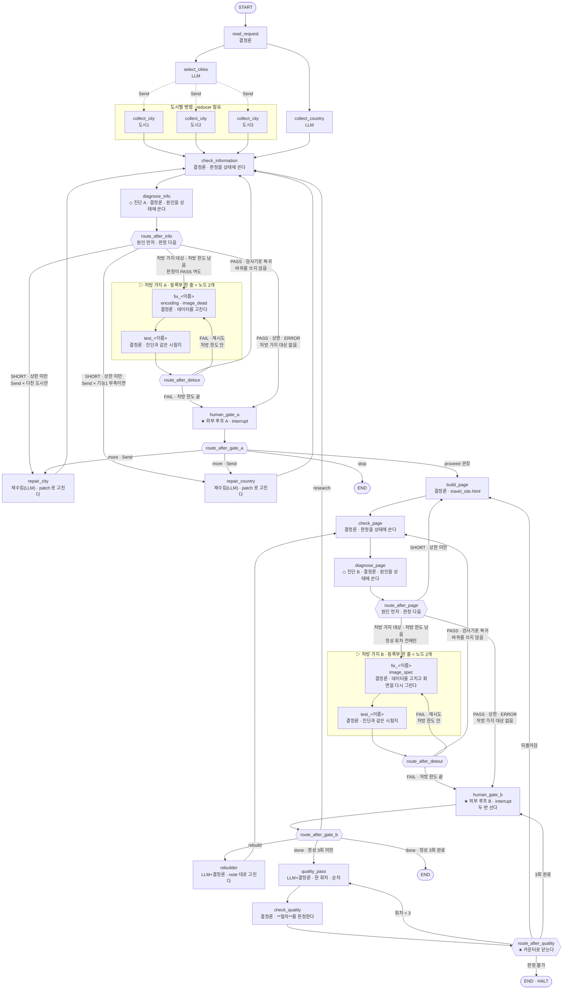

# 결정 장부

**무엇을 정했고, 왜 그렇게 정했는지**가 모이는 곳입니다. 결정을 바꿀 때도 여기에 남깁니다.

---

## 1. 결정 13개 현황

<!-- PROJECT:BEGIN -->

| STEP | 결정 ID | 확정 값 | 이유 | 시각 |
| --- | --- | --- | --- | --- |
| 1 | `G-상태범위` | B — 판정에 필요한 것 + 제어 필드 | 제어 필드가 있어야 라우터가 상한에서 멈춘다 | 2026-10-23 |
| 1 | `G-원본보관` | B — 파일에 두고 경로만 상태에 | 상태는 노드마다 통째로 저장되므로 원문을 넣지 않는다 | 2026-10-23 |
| 1 | `G-판정필드` | A — 남긴다 (`*_verdict`) | 라우터가 값만 읽고 경로만 고른다 | 2026-10-23 |
| 2 | `G-노드개수` | B — 킷 매핑 (루프 골격 14개) | 검사기가 노드이고 재수집이 fan-out 이어야 한다 | 2026-10-23 |
| 2 | `G-검사기노드화` | A — 노드로 넣는다 | 라우터가 판정 값만 읽고 경로만 고른다 | 2026-10-23 |
| 2 | `G-실행주체` | B — (5)번 표대로 섞는다 | 판정에 LLM이 끼면 안 된다 | 2026-10-23 |
| 3 | `G-라우터판단` | B — 허용값이 정해진 필드만 본다 | 문장 해석에 제어가 좌우되지 않게 한다 | 2026-10-23 |
| 3 | `G-상한처리` | B — 게이트로 보내 사람이 정한다 | 상한에 걸린 것은 판단이 필요한 상황이다 | 2026-10-23 |
| 4 | `G-병렬범위` | B — 도시별 (+ 국가정보와 도시선정) | 도시끼리 독립 | 2026-10-23 |
| 4 | `G-병렬충돌` | C — 이름 기준 upsert reducer | 재수집이 같은 도시를 다시 줘서 add 면 중복 | 2026-10-23 |
| 5 | `G-체크포인터` | A — Agent Server 것을 쓴다 (compile 에 안 붙임) | Studio 가 영속화를 담당 | 2026-10-23 |
| 5 | `G-게이트위치` | B — 루프 A 끝 + 루프 B 끝 (2곳) | 판단이 필요한 두 지점 | 2026-10-23 |
| 5 | `G-게이트선택지` | B — 선택지 + 현황 + 권장 | 근거를 보고 고르게 한다 | 2026-10-23 |

<!-- PROJECT:END -->

---

## 2. 잠긴 것 (교육생이 정하지 않는다)

| 항목 | 값 | 왜 잠갔나 |
| --- | --- | --- |
| 개수 계약 · 화면 계약 · **정성 계약** | `graph/03_CONTRACT.json` | 바꾸면 루프판과 같은 자로 못 잰다 |
| 검사기 3개 | `check_information_count.py` · `check_page_contract.py` · `check_quality_passes.py` | 루프 킷 파일과 **바이트 단위로 같다** |
| 검사기 1개 (신규) | `check_graph_shape.py` (검사행 12개 · **11번 = 처방 가지 계약**) | AI가 자기 채점표를 만들면 스스로 통과시킨다 |
| **정성 규율 10가지** | `specs/QUALITY_RUBRIC.md` | 규율을 스스로 정하면 통과하기 쉬운 것만 남는다 |
| **정성 회차 수** | **3회. 줄이지도 늘리지도 않는다** | 점수로 닫으면 글 쓴 쪽이 자기 글에 점수를 준다 |
| 노드 배선 | `travel_graph/build.py` (루프 골격 14 · 진단 2 · 처방 가지는 등록부를 읽어 자동으로) | 배선을 손으로 짜는 데 시간을 쓰지 않는다 |
| 페이지 생성 | `travel_graph/page.py` | 화면 이름표가 계약으로 고정돼 있다 |
| 수집 방식 | `travel_graph/research.py` | `claude -p` 호출 규약 · 이미지 실측 확인 |
| **정성 회차 절차** | `travel_graph/quality.py` | 해시 사슬과 되돌아감 확인이 기록의 근거다 |
| **처방 가지 킷 모듈** | `travel_graph/detours/` 의 `__init__.py` · `log.py` · `encoding.py` · `image_dead.py` · `image_spec.py` · `_template.py` | 규칙 처방 가지는 모두 **같은 모양**(진단 → fix → test → 검사기 복귀)이라야 틀릴 곳이 없다. 모양은 킷이 쥔다 |
| **처방 가지 킷 시험지** | `scripts/detour_tests/` 의 `_common.py` · `test_encoding.py` · `test_image_dead.py` · `test_image_spec.py` · `_template_test.py.tmpl` | 진단과 합격을 **같은 시험지**로 본다. 고치는 쪽이 시험지를 고치면 스스로 합격시킨다 |
| **처방 가지 등록부** | `travel_graph/detours/registry.py` — **STEP 6 (조건부)에서 한 줄 추가만** (`scripts/new_detour.py` 가 해 준다) | 순서가 곧 진단 우선순위다. 킷의 세 줄을 지우거나 순서를 바꾸면 킷 기본 가지가 사라지거나 뒤로 밀린다 |
| 처방 가지 도구 | `scripts/new_detour.py` (세 조각 생성기) · `scripts/failure_report.py` (실패 기록 보고서) | 세 조각이 맞물리는 모양을 사람이 손으로 맞추지 않게 한다 |
| **처방 한도** | **2회** (`travel_graph/detours/__init__.py` 의 `LIMIT`) | 처방 가지가 사람을 대신하지 않는다. 한도를 다 쓰면 그 루프의 게이트로 간다 (바퀴 상한 3 · 처방 한도 2 — 서로 다른 칸) |

---

## 3. 그래프 구조도

### 3-1. 루프 세 개(A · B · C)가 어디로 갔나

| 루프 | 그래프의 안쪽 순환 | 그래프의 바깥 순환 (★ 사람) | 처방 가지 순환 (▷ 진단에서만) |
| --- | --- | --- | --- |
| A 정보량 | `check_information → diagnose_info → repair_city → check_information` (Send · 다친 도시만) | `human_gate_a → repair_city` | 복귀 `diagnose_info → fix_<이름> → test_<이름> → check_information` · 재시도 `test_<이름> → fix_<이름>` (encoding · image_dead) |
| B 페이지 | `check_page → diagnose_page → build_page → check_page` | `human_gate_b → rebuilder → check_page` **또는** `→ check_information` | 복귀 `diagnose_page → fix_<이름> → test_<이름> → check_page` · 재시도 `test_<이름> → fix_<이름>` (image_spec) |
| **C 정성** | `quality_pass → check_quality → quality_pass` **(고정 예산)** | `check_quality → build_page` 되돌아감 | 없음 — 정성 회차가 한 번이라도 돌면 처방 가지 B 도 쉰다 (파일 해시 사슬 보호) |

**바깥 순환이 루프에 없던 것입니다.** 특히 `human_gate_b → check_information` 은
"페이지 단계에서 정보 수집 단계로 되돌아가기"로, 루프에서는 불가능했습니다.

**처방 가지 순환도 루프에 없던 것입니다.** 루프는 모든 실패를 "한 바퀴 더"(재수집)로 뭉쳐
처리했지만, 그래프는 **알아본 실패**에만 규칙 처방 가지를 엽니다. 진단 노드가 원인(`failure_kind`)을
상태에 적고, "정해진 고칠 법이 있는 문제"만 처방 가지로 보냅니다 — 나머지는 재수집(LLM)이 맡습니다.
처방 가지는 규칙대로 고치고(fix = 처방) → 같은 시험지로 다시 재고(test = 재검) →
**그 루프의 검사기로 돌아옵니다** — 수집 노드로 돌아가면 합류가 영영 기다리기 때문이고,
계약은 루프 킷과 같은 검사기로 다시 재야 하기 때문입니다 (판정 독립).

**fan-out 도 두 번 나옵니다.** 첫 수집(`fan_out_cities`)은 고른 도시를 전부,
재수집(`fan_out_repairs`)은 **지적된 것만** 보냅니다 — 도시와 국가 소개 둘 다.
국가는 하나뿐이라 갈래가 0 또는 1 이고, 그래서 `country_intro` 에는 reducer 가
필요 없습니다(한 걸음에 쓰는 노드가 하나뿐). 그래서 `cities` reducer 는
`operator.add` 가 아니라 이름으로 덮어쓰는 `merge_cities` 여야 합니다 —
되돌아오는 간선이 있는 그래프에서 reducer 는 **멱등**해야 합니다.

**순환이 넷에서 여섯으로 늘었습니다.** 늘어난 둘이 루프 C이고,
그중 하나는 앞의 것들과 **모양이 다릅니다** — `verdict` 가 아니라 **카운터**로 닫힙니다.
되돌아감 경로의 상한은 `loop_b_iter` 를 그대로 씁니다. 별도 상한을 만들지 않습니다.

**처방 가지가 붙으면서 가지마다 순환이 둘 더 생겼습니다** — 복귀(`test → 검사기`)와
재시도(`test → fix`). 둘 다 `route_after_detour` 가 `detour_limit`(처방 한도 2회)을 보고 닫습니다.
복귀 간선은 **루프 골격의 바퀴를 쓰지 않습니다.** 처방 가지에서 합격하고 돌아온 방문은
`loop_a_iter` · `loop_b_iter` 로 세지 않고 '같은 오류 반복'도 올리지 않습니다 — 그래서
가지가 돌아도 재수집 기회가 줄지 않고, 루프판 비교표의 "반복 횟수"도 같은 뜻으로 비교됩니다.

> `check_graph_shape.py` 7번 검사는 겹치는 경로까지 따로 세어 순환을 찾습니다 —
> 루프 골격 14 만 있을 때 **10개**, 킷 기본 처방 가지 3개가 붙은 지금은 **27개**입니다.
> 늘어난 17개 중 6개가 가지마다 복귀 · 재시도 둘이고, 나머지 11개는 가지가 처방 한도에
> 걸려 게이트로 나가는 길이 루프 골격의 순환에 끼어든 변형입니다.
> 세는 단위가 다를 뿐이며, 개념상 순환은 여섯입니다 (안쪽 2 · 바깥 2 · 정성 2)
> **+ 처방 가지마다 복귀 · 재시도 둘.** 종류로 묶으면 **넷**(안쪽 · 바깥 · 정성 · 처방 가지)이고,
> 강의 지도의 "순환은 넷"이 이것입니다.

---

## 4. 게이트 답 기록 (루프의 되물음)

<!-- PROJECT:BEGIN -->

| 시각 | 게이트 | 판정 | 못 채운 칸 | 내가 고른 것 | 이유 |
| --- | --- | --- | --- | --- | --- |
| (없음) | | | | | |

<!-- PROJECT:END -->

---

## 5. 결정을 바꿀 때

1. 1번 표의 그 줄은 새 값으로 고치고, 아래 5-1 표에 시각 / 결정 ID / 이전 값 / 새 값 / 이유 / 다시 볼 STEP 을 한 줄 남긴다.
2. 영향받는 STEP 문서의 `STATUS` 를 `NEEDS_REVIEW` 로 바꾼다.
3. 사람에게 영향 범위를 표로 보여 주고 확인을 받는다.
4. 바꾼 STEP 마다 `python scripts/validate_specs.py --step N` 으로 형식을 다시 확인한다
   (N = 1~5). 인자 없이 돌리면 STEP 6 까지 보는데, STEP 6 은 조건부라 하지 않았으면 SHORT(exit 2)로
   남는다 — **STEP 6 미작성은 정상**이다.

### 5-1. 결정을 바꾼 기록

<!-- PROJECT:BEGIN -->

| 시각 | 결정 ID | 이전 값 | 새 값 | 이유 | 다시 볼 STEP |
| --- | --- | --- | --- | --- | --- |
| — | — | — | — | 아직 없음 | — |

<!-- PROJECT:END -->

---

## 6. 처방 가지 기록 (STEP 6 · 조건부)

STEP 6 에는 결정이 없습니다. 로그에 후보가 있어 STEP 6 을 했다면,
**반복된 실패 하나를 무슨 처방 가지로 만들었는지** 여기에 한 줄로 남깁니다. 자세한 기록은 `specs/06_DETOUR.md` 의 MACHINE `detour`
블록에 있고, 여기에는 요약만 둡니다. 킷 기본 처방 가지 3개(`encoding` · `image_dead` · `image_spec`)는
적지 않습니다. STEP 6 을 하지 않았으면(후보 없음) 아래 표는 `(없음)` 그대로 둡니다.

**누가 · 언제:** `graph-detour-builder` 스킬이 STEP 6 의 마지막 **기록 단계**(`06_DETOUR.md` MACHINE `detour`
블록을 채우고 `validate_specs.py --step 6` 이 PASS 한 뒤)에 처방 가지 하나당 한 줄 적습니다. 빨간불 · 초록불은
`run_once.py` 끝의 history 줄에서, 회귀는 `check_graph_shape.py` · `run_graph_regression.py` 결과에서 옮깁니다.
위 1번 표(결정)에는 적지 않습니다 — STEP 6 은 결정 0개입니다.

<!-- PROJECT:BEGIN -->

| 시각 | 처방 가지 (kind) | 루프 | 증상 (실패 기록 어디서 봤나) | 시험지 (`test_<이름>.py` 가 보는 것) | 고치는 법 (`fix()` 1회째 → 2회째) | 결과 (빨간불 → 초록불 → 회귀) |
| --- | --- | --- | --- | --- | --- | --- |
| (없음) | | | | | | |

<!-- PROJECT:END -->

- **결과** 칸에는 셋을 다 적습니다 — 그 실패를 재현(`--inject <이름>`)하면 시험지가 불합격해 게이트에서
  멈춘다(빨간불) · 고치면 test PASS 로 검사기에 복귀한다(초록불) · `check_graph_shape.py` 12행 PASS 와 회귀
  테스트 실패 0(킷 기본 240개 · 처방 가지 하나마다 11개씩 는다), 재현 없이 돌리면 가지 0회(회귀 — 루프 B
  가지는 `--auto proceed` 로 본다).
  예) `FAIL 2/2 → 게이트 A · PASS 1/2 → check_information · 12행 PASS · 회귀 251 · 실패 0 · 재현 없이 0회`
- **한 번은 일화, 세 번은 패턴.** 내 처방 가지는 내 킷에만 둡니다. 킷에 넣는 것은 로그에서 반복 확인된
  실패(강사가 여러 교육생 기록을 모아 3곳 이상을 센다 — `python scripts/failure_report.py <폴더>…` 의
  "패턴 — 킷 처방 가지 후보") **또는** 원인과 고칠 법이 이미 알려진 실패 축(예: 인코딩 — Windows cp949 ·
  현지 글자 파일명)입니다.
