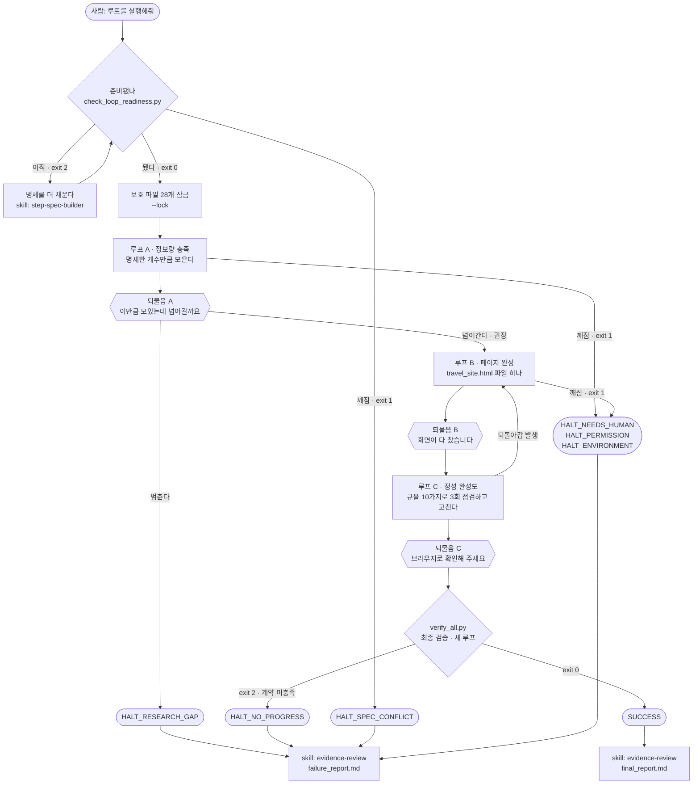
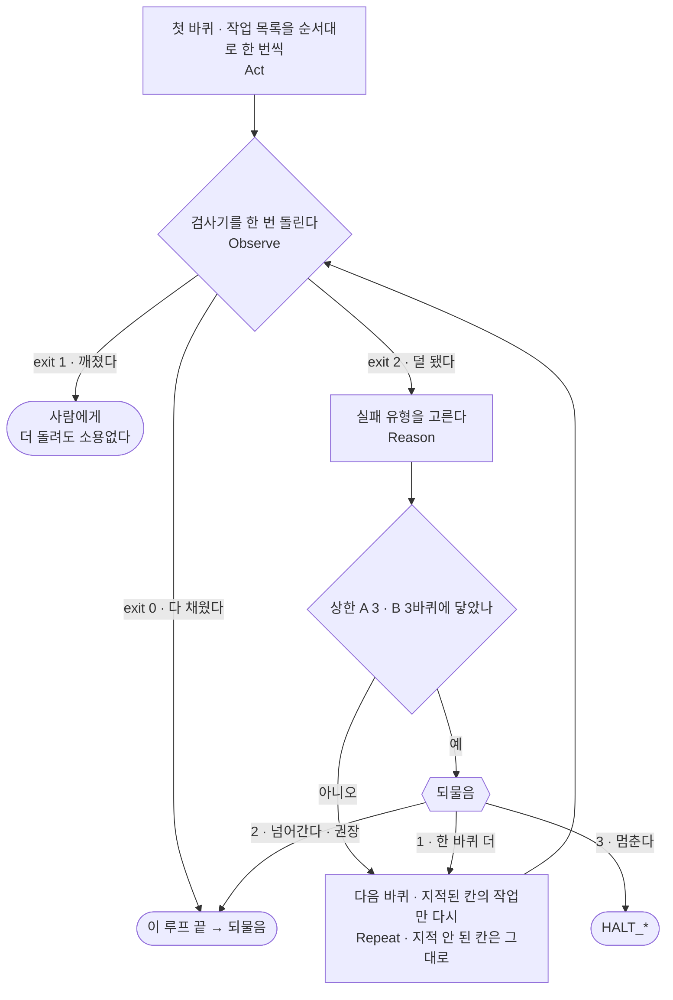
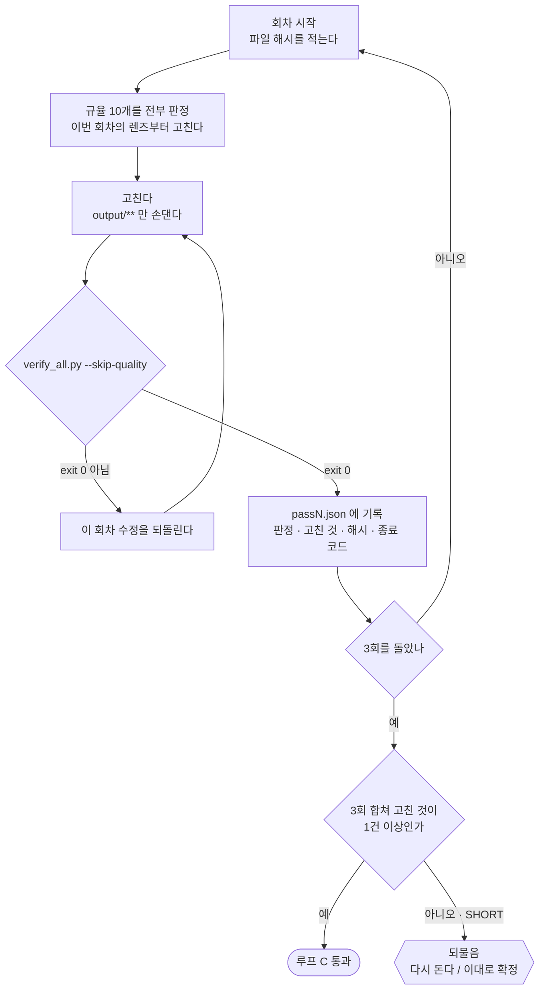
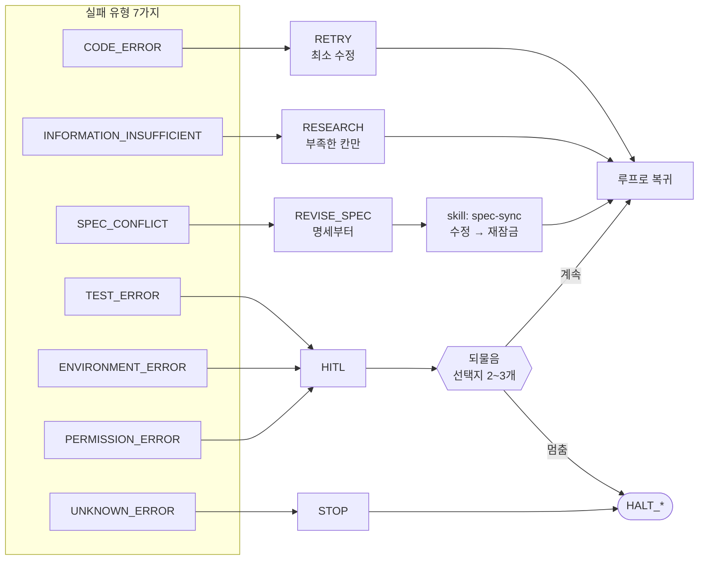
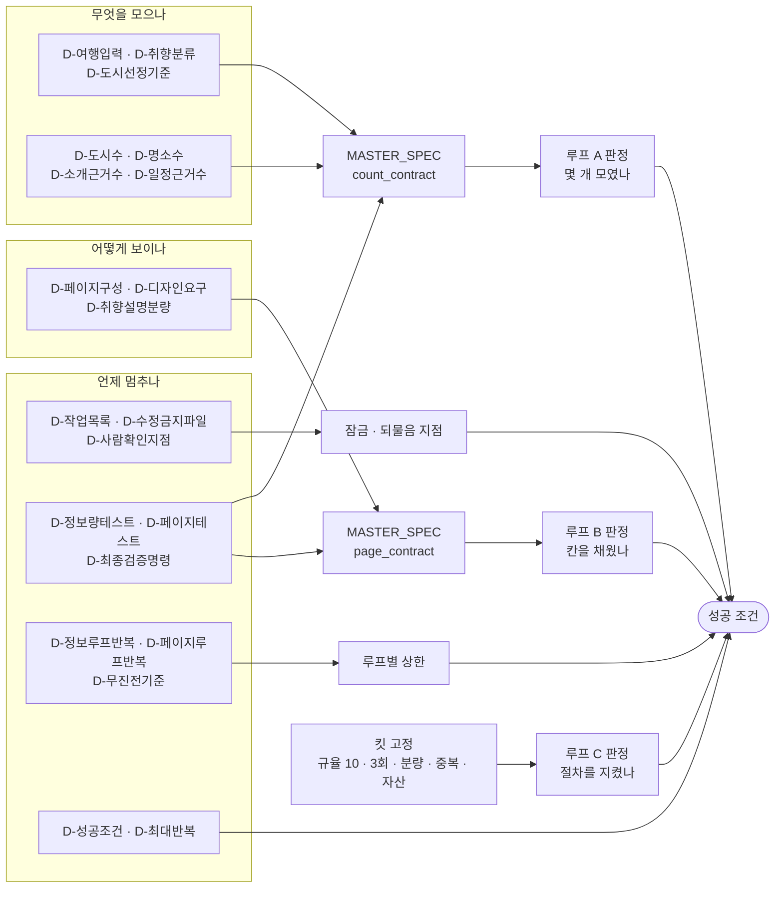

# 결정 장부

승인된 결정을 **한 줄씩** 쌓는 곳입니다. 나중에 "왜 이렇게 정했지?"를 여기서 찾습니다.

- 값을 바꿀 때는 **덮어쓰지 않고 새 줄을 추가**합니다.
- 이전 값 · 새 값 · 이유 · 시각 · 영향받는 STEP을 반드시 남깁니다.

---

## 1. 확정된 결정 (21개)

<!-- PROJECT:BEGIN -->

| STEP | 결정 ID | 확정 값 | 이유 | 시각 |
| --- | --- | --- | --- | --- |
| 1 | `D-여행입력` | 일본(오사카) · 4일 (11/13~16) | 고베 일정을 지워 달라는 요청으로 도시를 오사카 하나로 줄임 (spec-sync) | 2026-10-23 |
| 1 | `D-취향분류` | 3갈래 (Preferred / Not preferred / Detailed preference) | 권장값 | 2026-10-23 |
| 1 | `D-도시선정기준` | 1등 내 취향 · 2등 유명도 · 3등 교통 | 맛집 취향 우선, 그다음 유명도와 이동 편의 | 2026-10-23 |
| 2 | `D-페이지구성` | 기능1 accordion · 기능2 drawer · 기능3 accordion | 권장값 A. 도시→서랍→관광지 흐름 | 2026-10-23 |
| 2 | `D-디자인요구` | 어두운 배경(dark) · 청록 강조(#14B8A6) | 교육생 선택 B | 2026-10-23 |
| 2 | `D-취향설명분량` | 도시마다 15줄 이상 | 권장값 B | 2026-10-23 |
| 3 | `D-도시수` | 1 (오사카) | 고베 일정을 지워 달라는 요청으로 2 → 1 (spec-sync) | 2026-10-23 |
| 3 | `D-명소수` | 3 | 권장값 | 2026-10-23 |
| 3 | `D-소개근거수` | 3 | 교육생 선택 (권장 2보다 풍성) | 2026-10-23 |
| 3 | `D-일정근거수` | 2 | 권장값 | 2026-10-23 |
| 4 | `D-작업목록` | 권장 7개 (A 5개 · B 2개) | 권장값 | 2026-10-23 |
| 4 | `D-수정금지파일` | specs/** scripts/** templates/** CLAUDE.md MASTER_SPEC.md LOOP_CONTRACT.md | 권장값 C | 2026-10-23 |
| 4 | `D-사람확인지점` | 루프 A 끝 · B 끝 · C 끝 | 권장값 | 2026-10-23 |
| 5 | `D-정보량테스트` | 개수와출처와분량 | 권장값 C. 껍데기 통과 차단 | 2026-10-23 |
| 5 | `D-페이지테스트` | 내용대조 | 권장값 C. 내용이 칸에 들어갔는지까지 확인 | 2026-10-23 |
| 5 | `D-최종검증명령` | python scripts/verify_all.py | 권장값 A. 순서 강제 | 2026-10-23 |
| 6 | `D-정보루프반복` | 3바퀴 | 권장값 | 2026-10-23 |
| 6 | `D-페이지루프반복` | 3바퀴 | 권장값 | 2026-10-23 |
| 6 | `D-무진전기준` | 같은 오류 2회 | 권장값 | 2026-10-23 |
| 7 | `D-성공조건` | verify_all.py exit 0 + 사람이 브라우저로 열어 확인 | 권장값 B. 사진 일치는 사람 눈 | 2026-10-23 |
| 7 | `D-최대반복` | 10번 | 권장값 A | 2026-10-23 |

<!-- PROJECT:END -->

---

## 2. 결정을 바꾼 기록

<!-- PROJECT:BEGIN -->

| 시각 | 결정 ID | 이전 값 | 새 값 | 이유 | 다시 볼 STEP |
| --- | --- | --- | --- | --- | --- |
| 2026-10-23 | 스타일 원문 (`D-취향분류` 값은 그대로) · `D-여행입력` 날짜 메모 | Preferred 맛집 · 날짜 없음 | Preferred 맛집·휴식·쇼핑 · 날짜 11/13~16(3박4일) | STEP 4 진행 중 교육생이 새 스타일·날짜를 적어 spec-sync 로 반영 | STEP 1 (재승인) · 값·숫자 변화 없어 STEP 2~7 영향 없음 |
| 2026-10-23 | `D-도시수` · `D-여행입력`(도시 후보) | 2 (오사카 · 고베) · 도시 후보 오사카·고베 | 1 (오사카) · 도시 후보 오사카 | 교육생이 "고베일정은 지워줘"라고 요청. 관광지 6→3곳 · 이미지 8→5장 · 일정 칸 8→4일치 | STEP 1 · 3 · 4 · 5 · 7 (재승인) · MASTER_SPEC.md |

<!-- PROJECT:END -->

---

## 3. Claude가 대신 정한 값 (가정)

영향이 작은 값만 여기에 들어갑니다. **국가 · 일수 · 스타일 같은 값은 절대 여기 오지 않습니다.**

<!-- PROJECT:BEGIN -->

| 시각 | 항목 | 정한 값 | 왜 대신 정했나 | 교육생 확인 |
| --- | --- | --- | --- | --- |
| 2026-10-23 | 청록 강조 색상값 | #14B8A6 (배경은 어두운 톤) | "청록"만 선택되어 구체 색상 코드가 없음. 화면 분위기뿐이고 검사 대상이 아님 | 확인 필요 (바꾸려면 알려 주세요) |

<!-- PROJECT:END -->

---

## 4. 되물음 기록 (루프 실행 중)

루프가 나에게 물어본 것과 내가 고른 답입니다.

> 루프가 도는 동안에는 이 파일(`specs/**`)이 `--lock` 으로 잠겨 있어 여기에 바로 적지 않습니다.
> 답은 `PROJECT_MEMORY.md` **7번**에 남깁니다. `spec-sync` 로 명세를 고치느라 잠금을 풀었을 때만 여기에도 옮깁니다.

<!-- PROJECT:BEGIN -->

| 시각 | 어느 루프 | 상황 | 내가 고른 것 |
| --- | --- | --- | --- |
| — | — | 아직 없음 | — |

<!-- PROJECT:END -->

---

## 5. 이 결정들이 만든 루프 구조도

위에서 고른 **21개가 합쳐지면 어떤 루프가 되는지**를 그림으로 보여 줍니다.
STEP 7에서 Claude가 확정 값을 넣어 다시 그립니다. 지금은 숫자 자리가 비어 있습니다.

> 이 그림은 **결정의 결과**입니다. 그림을 고쳐도 루프는 바뀌지 않습니다.
> 루프를 바꾸려면 결정을 바꾸고(`spec-sync`), 그다음 이 그림을 다시 그립니다.

**이 그림이 코드 덩어리로만 보인다면**

VS Code 기본 미리보기는 mermaid를 그려 주지 않습니다. 셋 중 하나를 하세요.

| 방법 | 하는 법 |
| --- | --- |
| **확장 설치** (권장 · 한 번만) | 터미널에 `code --install-extension bierner.markdown-mermaid` → 이 파일에서 `Ctrl+Shift+V` |
| 웹에 붙여넣기 | <https://mermaid.live> 에 ```` ```mermaid ```` 안쪽만 복사해 넣기 |
| GitHub에 올려서 보기 | GitHub는 `.md` 안의 mermaid를 그대로 그려 줍니다 |

> 그림을 **텍스트로 둔 이유**는 결정이 바뀌면 그림도 바뀌어야 하기 때문입니다.
> 이미지 파일로 두면 숫자가 바뀌어도 그림은 옛날 그대로 남습니다.

**그림 기호**

```text
네모   작업        루프가 하는 일
마름모 판정        검사기가 종료 코드를 낸다
육각형 되물음      사람이 고른다
둥근   종료 상태    여기서 루프가 끝난다
```

<!-- PROJECT:BEGIN -->

### 5-1. 큰 그림 — 처음부터 끝까지



**세 루프가 무엇을 하나**

| 루프 | 작업 | 판정기 |
| --- | --- | --- |
| **A 정보량** | `TASK-입력읽기` → `TASK-국가정보` → `TASK-도시선정` → `TASK-명소수집` → `TASK-일정수집` | `check_information_count.py` |
| **B 페이지** | `TASK-페이지생성` → `TASK-기능점검` | `check_page_contract.py` |
| **C 정성** | `TASK-정성점검` × 3회 (킷 고정) | `check_quality_passes.py` |

**네 가지만 기억하면 됩니다**

1. **앞 루프가 통과해야 뒤 루프로 갑니다.** `verify_all.py`가 순서를 강제합니다.
2. **실패해도 처음으로 돌아가지 않습니다.** 부족한 칸만 다시 합니다.
3. **상한에 걸려도 그냥 멈추지 않습니다.** 되물음이 뜨고 사람이 고릅니다.
4. **루프 C만 모양이 다릅니다.** 통과선이 아니라 **정해진 3회**로 닫습니다.

> 루프 B에서 "부족한 채로 마친다"를 고르면 `SUCCESS`가 아니라 `HALT_NO_PROGRESS`입니다.
> 화면 계약을 못 채운 것을 성공이라고 부르지 않습니다.

---

### 5-1b. 한 바퀴 안에서 무슨 일이 일어나나

루프 A와 루프 B **둘 다 같은 모양**입니다. 이것만 이해하면 됩니다.



```text
루프 A 에서   검사기 = check_information_count.py   고치는 곳 = research_data.json
루프 B 에서   검사기 = check_page_contract.py       고치는 곳 = travel_site.html

첫 바퀴      작업 목록을 순서대로 한 번씩 → 검사기 한 번   (검사기는 결과물 전체를 본다)
다음 바퀴    부족으로 지적된 칸의 작업만 → 검사기 한 번    (지적 안 된 칸은 손대지 않는다)
```

---

### 5-1c. 루프 C만 모양이 다르다 — 통과선이 없는 루프



```text
왜 점수가 아니라 회차인가
   품질 점수를 종료 조건으로 쓰면 글을 쓴 쪽이 자기 글에 점수를 준다 → 조건⑤ 붕괴
   반복 횟수는 관측 가능하고, 늘기만 하고, 반드시 3에 닿는다 → 종료 조건으로 건전하다

그럼 3번 "이상 없음"만 적고 끝낼 수 있지 않나
   그래서 판정기가 절차를 본다 —
   위반이라 적었으면 고쳤는가 / 고쳤다면 파일 해시가 바뀌었는가 /
   안 고쳤다면 그대로인가 / 회차 끝마다 루프 A·B 가 여전히 통과하는가 /
   3회 합쳐 고친 것이 0건이면 SHORT — 흠이 없는 것과 보지 않은 것을 기록으로 가를 수 없어
   되물음(다시 돈다 / 이대로 확정)
```

---

### 5-2. 실패하면 어디로 가나 (고정 라우팅)



**같은 오류가 `D-무진전기준`만큼 반복되면** 어느 경로든 되물음으로 빠집니다.

```text
오류 지문 = sha256(검사기 이름 + 실패 유형 + 오류 첫 줄)
```

---

### 5-3. 내가 고른 값이 그림의 어디를 정하나



| 고른 값 | 그림에서 바뀌는 곳 |
| --- | --- |
| `D-도시수` `D-명소수` | 루프 A가 몇 칸을 채워야 하는가 |
| `D-소개근거수` `D-일정근거수` | 한 칸에 근거가 몇 건 필요한가 |
| `D-페이지구성` | 루프 B가 찾을 칸의 모양 |
| `D-취향설명분량` | 루프 A·B **양쪽**에서 세는 줄 수 |
| `D-정보량테스트` `D-페이지테스트` | 판정기가 얼마나 깐깐한가 |
| `D-정보루프반복` `D-페이지루프반복` | 되물음이 언제 뜨는가 |
| `D-성공조건` | `SUCCESS` 앞에 사람 확인이 붙는가 |
| (내가 안 고름) | 루프 C의 규율 10가지와 3회는 **킷이 정합니다** |

---

### 5-4. 그래프로 옮긴다면 (다음 강의 미리보기)

이 그림이 그대로 그래프가 됩니다.

| 지금 (루프) | 그래프로 가면 | 비고 |
| --- | --- | --- |
| 작업 네모 (`TASK-명소수집` 등 7개) | **루프 골격 노드** | 하나가 하나는 아니다 — 작업 8개(정성점검 포함)가 루프 골격 노드 14개가 된다 (검사기 · 게이트 · 재수집도 노드) |
| 종료 코드 화살표 | **조건부 간선** | `exit 0 / 1 / 2` |
| 실패 라우팅 7종 | **간선 조건표** | 이미 고정돼 있어 그대로 옮긴다 |
| (루프에는 없음) | **진단 노드 2개 + 규칙 처방 가지** | 검사기 바로 뒤에서 원인을 가려, 정해진 고칠 법이 있는 실패만 처방 가지(고치고 → 시험 → 검사기로 복귀)로 보낸다 |
| `state/loop_state.json` | **그래프 상태** | 필드가 곧 상태 스키마 |
| 되물음 | **게이트 노드 2개** (`human_gate_a` · `human_gate_b`) | `interrupt` 로 멈춰 사람의 답을 받는다. 무엇을 고를지는 그래프 밖의 사람이 정한다 (바깥 루프는 사람 소유) |
| 루프 C 3회 | **고정 예산 루프** | 회차 번호가 상태에 있어야 라우터가 센다 |
| `MASTER_SPEC` 계약 | **노드 밖의 설정** | 노드가 계약을 읽는다 |

**여기서 사람이 계속 쥐고 있어야 하는 것**

```text
되물음의 답       부족해도 넘어갈지 말지
명세 변경 승인     기준을 바꾸는 일
마지막 눈 확인     정보가 사실인가
```

<!-- PROJECT:END -->
